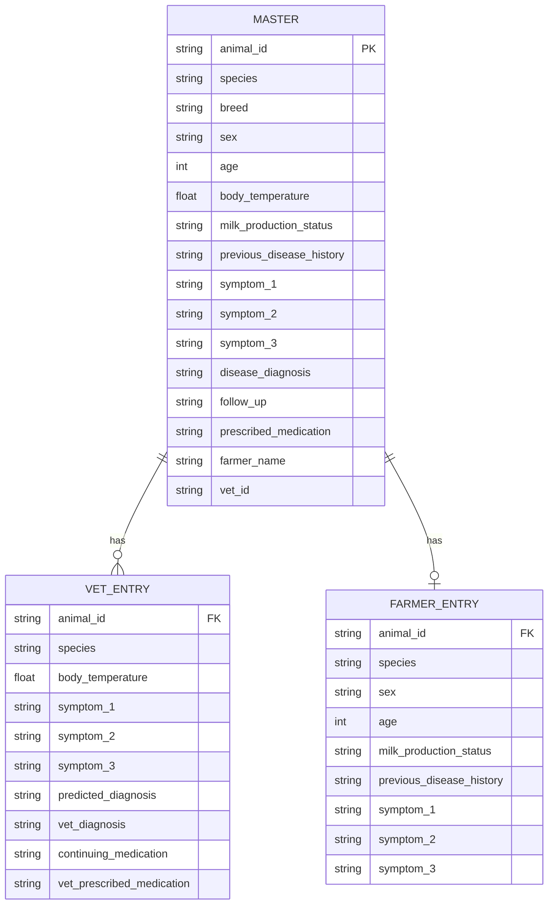

# 🌿 Herd Health Hub
### Cattle Health Management System

A full-stack platform for managing cattle health, connecting farmers and veterinarians, and keeping animal medical records, diagnoses, medication and follow-ups organised.
<p align="center">
  <a href="https://herd-healer-pro.lovable.app"><strong>🌱 Open Live Application →</strong></a>
</p>

<p align="center">
  
  
  
  
</p>

---


https://github.com/user-attachments/assets/c2c87f8b-fb2b-42a2-9b55-7b13abd5425d


## 📽️ Project Demo

<!-- Replace this comment with your uploaded GitHub video URL or add screenshots below. -->

<p align="center">
  <a href="https://herd-healer-pro.lovable.app">
    
  </a>
</p>

---

## 🌱 What the system does

Herd Health Hub brings animal registration, health records, veterinary visits, medication and follow-up tracking into a single system.

The application is organised around three roles: **Farmer, Veterinarian and Administrator**.

| Module | Capabilities |
|:--|:--|
| 👨‍🌾 Farmer Portal | Animal registration, personal animal records, health summaries, alerts and follow-up information |
| 🩺 Veterinary Portal | Animal search, medical history, examination records, diagnosis and medication management |
| 🛡️ Admin Portal *(optional)* | Manage farmers and vets, view records, and access reports and analytics |

## ✨ Features

### 👨‍🌾 Farmer Portal

- **Dashboard** — Summary cards, health alerts, follow-ups and vaccination status.
- **Register New Animal** — Capture animal details, symptoms and health information.
- **My Animals** — Browse registered cattle and access individual records.
- **Animal Profile** — View medical history, symptoms, diagnosis, prescribed medication and follow-up status.

### 🩺 Veterinary Portal

- **Vet Dashboard** — Overview of today's cases, follow-ups, continuing medication and vaccination due.
- **Search Animal** — Find an animal using its unique `animal_id`.
- **Medical Record** — View animal information alongside farmer-reported and veterinary-entered data.
- **Add / Update Visit** — Record examination details, predicted diagnosis, vet diagnosis, prescribed medication and follow-up requirements.
- **Treatment Tracking** — Mark whether medication is continuing and record the medicine prescribed.

### 🛡️ Administration *(optional)*

- Manage veterinarian and farmer accounts.
- View animal records across the system.
- Review reports and health analytics.

### 🔎 Health Monitoring

- Disease diagnosis and previous disease history.
- Body temperature and symptom tracking.
- Follow-up and continuing-medication indicators.
- Vaccination information and due-status visibility.
- Role-based navigation and responsive dashboards.

*Feature availability depends on the current application implementation.*

---

## 🗄️ Database Design

The requested data model uses three principal tables connected through `animal_id`.



### `Master`

Stores the main animal record, including identification, breed, age, sex, temperature, milk-production status, previous disease history, symptoms, diagnosis, follow-up, prescribed medication, farmer name and assigned vet ID.

### `Vet Entry`

Stores veterinary examination information, including observed symptoms, predicted diagnosis, veterinary diagnosis, continuing-medication status and prescribed medicine.

### `Farmer Entry`

Stores information reported by the farmer, including animal details, milk-production status, previous disease history and reported symptoms.

### Record relationships

The application joins records using `animal_id` to bring together:

- Core animal information from `Master`.
- Farmer-reported information from `Farmer Entry`.
- Veterinary examination and treatment information from `Vet Entry`.

This makes it possible to compare reported symptoms with veterinary findings and review an animal's history in one place.

---

## ⚙️ Backend and API Design

The backend needs to support the following operations.

| Resource | Operations |
|:--|:--|
| Authentication | Sign in, sign out, session handling and role checks |
| Animals | Create, list, search, view, update and delete records |
| Farmer entries | Record and retrieve farmer-reported information |
| Vet entries | Create and update examination and treatment records |
| Medical records | Retrieve joined animal, farmer and veterinary data |
| Follow-ups | Identify records requiring follow-up or continuing medication |
| Vaccinations | Retrieve vaccination status and upcoming due information |
| Administration | Manage users, records and reports where enabled |

The implementation uses Supabase services for database access and authentication, with PostgreSQL for relational data. Supabase Edge Functions can handle server-side operations that require them.

*These are the intended API capabilities; individual REST endpoints should be documented against the actual routes and functions implemented in the repository.*

---

## 🔐 Authentication and Access

The application provides separate workflows for farmers and veterinarians.

- Farmers access their animal records and farmer-facing features.
- Veterinarians access search, medical records, examination and treatment workflows.
- Administrators can access management and reporting features if the optional admin portal is enabled.

Database access policies should enforce the relevant permissions rather than relying solely on hiding frontend navigation items.

---

## 🛠️ Tech Stack

| Layer | Technology |
|:--|:--|
| Frontend | React, TypeScript, Vite |
| UI components | Tailwind CSS, shadcn/ui |
| Charts | Recharts |
| Database | PostgreSQL |
| Authentication | Supabase Auth |
| Backend services | Supabase Edge Functions |
| Realtime updates | Supabase Realtime |
| Development and hosting | Lovable Cloud |

---

## 🚀 Run Locally

### Prerequisites

- Node.js and npm
- Git
- A configured Supabase project or the backend environment required by the application

### 1. Clone the repository

```bash
git clone https://github.com/Aditya-Nair-Git/Herd_Health_Hub.git
cd Herd_Health_Hub
```

### 2. Install dependencies

```bash
npm install
```

### 3. Configure environment variables

Create a local `.env` file using the variable names expected by the codebase. For a typical Supabase frontend, these may resemble:

```env
VITE_SUPABASE_URL=your_supabase_project_url
VITE_SUPABASE_ANON_KEY=your_supabase_publishable_key
```

Use the exact names required by the project. Never commit credentials, service-role keys or private environment files.

### 4. Start the development server

```bash
npm run dev
```

Open the local URL shown in the terminal.

---

## 📁 Project Structure

A typical structure for this application may look like the following. Adjust it to match the actual repository.

```text
Herd_Health_Hub/
├── public/
├── src/
│   ├── components/
│   ├── pages/
│   │   ├── farmer/
│   │   ├── vet/
│   │   └── admin/
│   ├── hooks/
│   ├── integrations/
│   ├── lib/
│   └── types/
├── supabase/
│   ├── functions/
│   └── migrations/
├── assets/
├── .env.example
├── .gitignore
├── package.json
├── tsconfig.json
└── README.md
```

---

## 🔮 Possible Extensions

- Geographic visualisation of animal-health trends.
- Automated vaccination and follow-up reminders.
- More detailed veterinary workload and disease analytics.
- Exportable animal medical records.
- Improved mobile workflows for farmers and field veterinarians.
- Evaluation of additional disease decision-support methods.

---

## 🌾 Project Goal

The aim of Herd Health Hub is to make livestock health information easier to organise, improve access to animal medical histories, and support more consistent coordination between farmers and veterinarians.

**Live application:** [herd-healer-pro.lovable.app](https://herd-healer-pro.lovable.app)

<p align="center">
  <sub>Herd Health Hub · Cattle Health Management System</sub>
</p>
